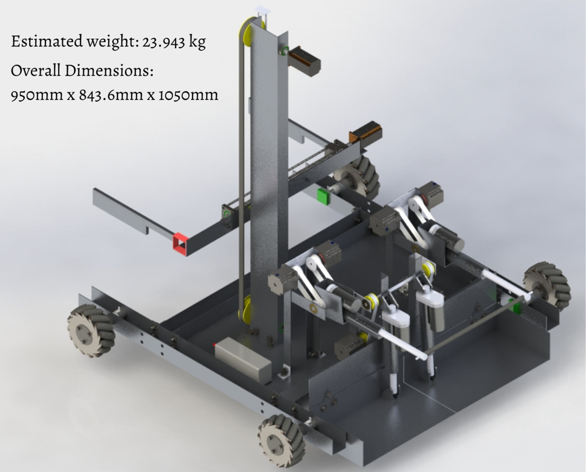
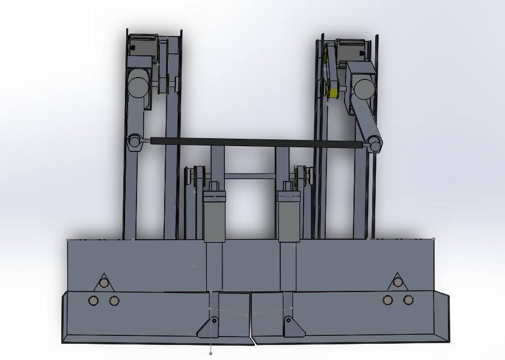
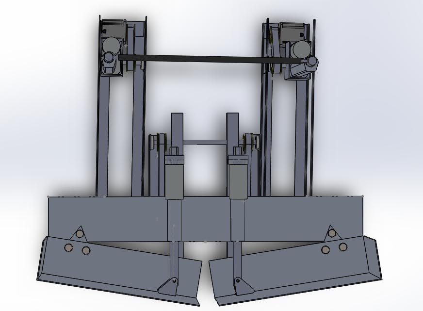
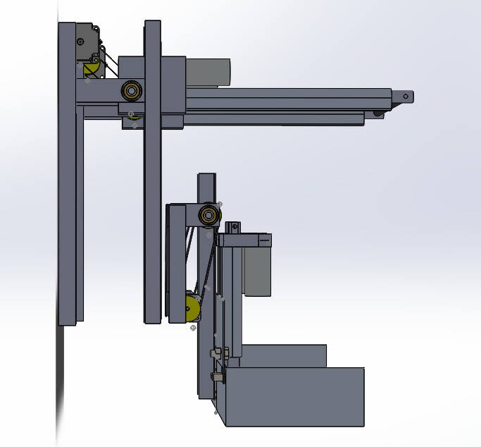
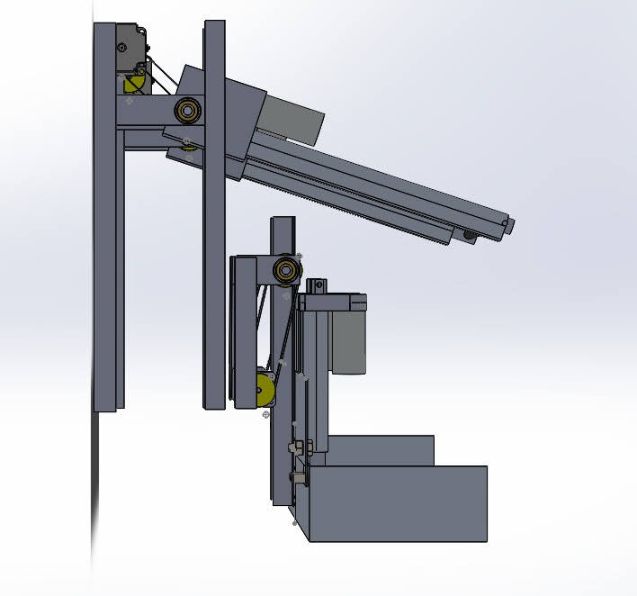

# ABU Robocon 2022 — Team IIT Jodhpur

Design, CAD and strategy for **Team Robocon IIT Jodhpur**'s entry to **ABU Robocon India 2022 (DD-Robocon)**, themed on the traditional game *Lagori*. Our stage 1 design document scored **100%** and qualified the team for the national round.

  

Robot R2 (Seeker) — estimated weight 23.9 kg, 950 × 843.6 × 1050 mm

## The challenge

Each team fields two robots:

- **R1 (Hitter)** shoots balls to knock down a pile of discs (the Lagori) and later targets the opponent's robot.
- **R2 (Seeker)** collects balls from a rack, passes them to R1, then picks the scattered discs and rebuilds the pile while dodging the opponent's shots.

## My contribution — R2 ball-picking mechanism

I designed the mechanism that lets R2 pull balls off the rack and hand them to R1.

  
  

  
  

1. **Demount.** At the start of the game R2 drives up to the ball rack and extends two linear actuators (BLA1, BLA2) holding a foam rod between them. A back-and-forth motion of the actuators, which can also rotate about their axis, knocks the balls off the rack.
2. **Collect.** The balls drop onto a two-part base-collector, a pair of flaps driven by linear actuators SLA1 and SLA2, so every ball is caught at once (ball radius R = 140 mm, pit depth h = 30 mm, pit diameter B = 100 mm).
3. **Deliver.** The collector tilts up to about 160 mm, the delivery height for R1, and the flaps swing open like doors to roll the balls into R1's receiving rack.

A free-body analysis sets the minimum force needed to topple a ball off the rack: with the ball's centre of mass at height x = R cos θ above the rack, the condition is |F(x + R cos φ)| ≥ Mg(B/2).

## What's in this repository

| Path | Contents |
|---|---|
| `ROBOCON_Design_Document_IITJ.pdf` | Full design document: strategy, mechanisms, materials, calculations |
| `CAD files/R1/` | R1 photos, STEP and STL files: chassis, ball path, shooter, parts |
| `CAD files/R2/` | R2 photos, STEP and STL files: chassis, ball picking, disc picking, mecanum wheels |
| `data_for_modeling_ml_models/` | Images and annotations used to train the targeting models |
| `images/` | Renders used in this README |

## Credits

Built by Team Robocon, IIT Jodhpur. Forked from [RoboticsClubIITJ/ABU-Robocon-2022](https://github.com/RoboticsClubIITJ/ABU-Robocon-2022).
